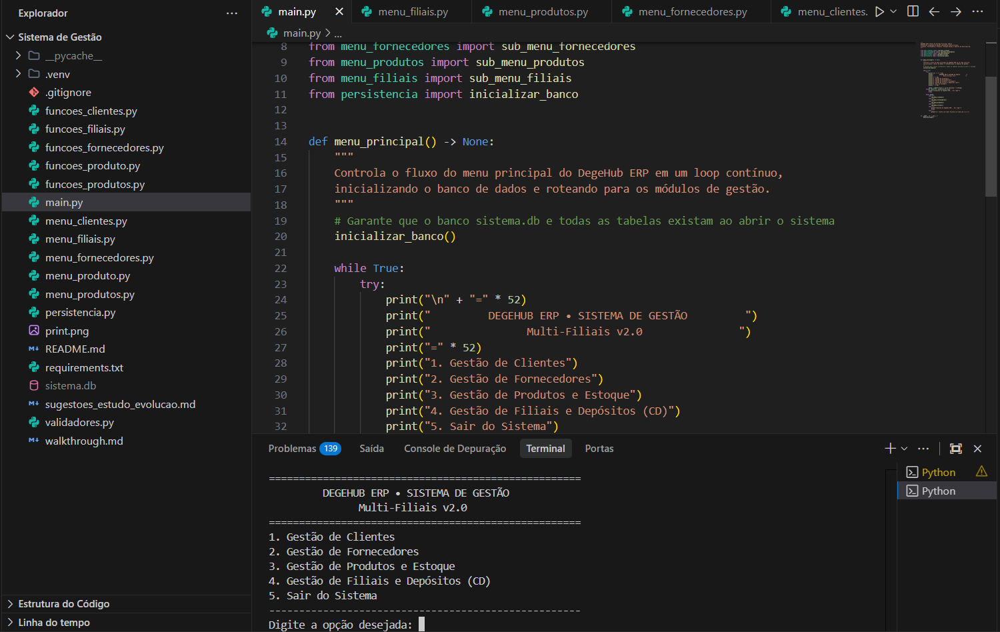

# 🏢 DegeHub ERP • Sistema de Gestão Empresarial Multi-Filiais

**DegeHub ERP** é uma plataforma de gestão comercial e controle de estoque multi-estabelecimentos desenvolvida em **Python 3.10+** com persistência relacional em **SQLite**. O projeto usa somente a biblioteca padrão e uma arquitetura modular em camadas, separando as responsabilidades de interface de linha de comando (CLI), regras de negócio/validação e persistência de dados, com relacionamentos relacionais, controle de concorrência com **transações atômicas**, auditoria de estoque (**Kardex**) e regras de **Soft Delete** (exclusão lógica).

---

## 📸 Demonstração do Sistema



---

## 🛠️ Tecnologias Utilizadas

- **Linguagem:** Python 3.10 ou superior (necessário para `match/case` e tipagem moderna).
- **Dependências:** somente a biblioteca padrão. Não é preciso instalar pacotes extras para rodar o sistema ou os testes.
- **Banco de Dados:** SQLite3 com suporte a `PRAGMA foreign_keys = ON`, `ON DELETE CASCADE` e constraints de validação (`CHECK`, `UNIQUE`). O arquivo `sistema.db` é criado e migrado automaticamente na inicialização.
- **Resiliência e Segurança:** context manager para transações atômicas com `ROLLBACK` automático e mecanismo de *retry* com backoff contra bloqueios de arquivo/disco (até 3 tentativas).
- **Rastreamento Temporal:** módulo `datetime` para registro de datas de cadastro, alteração cadastral, atualização de preços e timestamps de auditoria de movimentações.
- **Validações:** validação estrutural de documentos (CNPJ com suporte a isenção), telefones com DDD, e-mails, markups, preços e tipos de movimentações.
- **Autenticação:** no primeiro uso o sistema pede a criação do administrador. Senhas são gravadas somente como hash PBKDF2-HMAC-SHA256 com salt, nunca em texto puro. Perfis: `ADMIN`, `ESTOQUISTA` e `CONSULTA`.

---

## 🏗️ Arquitetura do Projeto

A aplicação segue uma estrutura modular para facilitar a manutenção e a evolução do código:

```text
Sistema de Gestão/
│
├── main.py                 # Ponto de entrada (menu principal)
├── sessao.py               # Sessão em memória do usuário autenticado
├── persistencia.py         # Camada de dados (conexão, transações e migrações)
├── validadores.py          # Validações de entradas
│
├── funcoes_admin.py        # Autenticação e CRUD de usuários
├── funcoes_clientes.py     # Regras de negócio do módulo de Clientes
├── funcoes_fornecedores.py # Regras de negócio do módulo de Fornecedores
├── funcoes_produtos.py     # Regras de negócio de Produtos, preços, notas e Kardex
├── funcoes_filiais.py      # Regras de negócio de Filiais, CDs e transferências
│
├── menu_admin.py           # Interface CLI de administração
├── menu_clientes.py        # Interface CLI de clientes
├── menu_fornecedores.py    # Interface CLI de fornecedores
├── menu_produtos.py        # Interface CLI de estoque, preços, notas e Kardex
├── menu_filiais.py         # Interface CLI de filiais e centros de distribuição
│
├── tests/                  # Suíte unittest (bancos SQLite temporários)
├── scripts/                # verificar.sh (Linux) e verificar.ps1 (Windows)
├── print.png               # Captura de tela da demonstração
└── sistema.db              # SQLite gerado automaticamente (não versionado)
```

Os arquivos `funcoes_produto.py` e `menu_produto.py` são apenas aliases de compatibilidade com os módulos no plural.

---

## 🚀 Funcionalidades por Módulo

### 🏬 1. Módulo de Filiais e Centros de Distribuição (CDs)
- **Classificação de Unidades:** suporte a **Lojas Físicas**, **Centros de Distribuição (CD / Depósito)** e **Lojas Virtuais (E-Commerce)**.
- **Flexibilidade Cadastral:** código único de identificação (ex: `CD-MATRIZ`, `LOJA-01`, `ECOM`), Nome Fantasia, Razão Social, Telefone e Endereço.
- **CNPJ com Isenção:** aceita CNPJs formatados no padrão `XX.XXX.XXX/XXXX-XX` ou o valor `0` para unidades virtuais ou sem CNPJ próprio.
- **Auto-vínculo de Produtos:** ao cadastrar uma nova filial, todos os produtos já ativos ganham automaticamente suas tabelas de preços e saldos (zerados) inicializadas.
- **Transferência de Estoque entre Unidades:**
  - Permite transferir mercadorias de uma filial de origem para uma filial de destino em uma única transação atômica.
  - Registro automático no Kardex com `TRANSFERENCIA_SAIDA` e `TRANSFERENCIA_ENTRADA`.
- **Distribuição CD ➔ Loja:** com um CD ativo, o menu de estoque exibe **Distribuição de Produtos**, restrita à origem em CD. Sem CD, a opção não aparece.
- **Trava de Segurança na Inativação:** impede a inativação de uma filial caso ela ainda possua saldo positivo de mercadorias em estoque (`quantidade > 0`).

---

### 📦 2. Módulo de Produtos, Preços e Estoque Segregado
- **Separação de Saldos por Filial:** a quantidade em estoque fica na tabela `saldos`, por filial (com suporte a estoque mínimo e alertas de reposição).
- **Tabela de Preços e Promoções por Loja:**
  - Precificação independente por filial na tabela `precos`.
  - **Promoções exclusivas:** uma promoção é específica de produto e unidade, com número, vigência (início e fim opcional) e usuário responsável. A promoção ativa dentro da vigência define o preço promocional daquela loja, sem alterar o preço regular das demais.
- **Markup Multiplicador e Recálculo Automático:**
  - Cálculo automático: preço de venda = preço de custo × markup.
  - Se o markup for `0`, permite a digitação manual do preço de venda final.
- **Vínculo Obrigatório com Fornecedores:** bloqueia o cadastro caso não existam fornecedores ativos cadastrados.
- **Entrada de Notas:** recebe fornecedor, unidade de destino e vários itens; a confirmação atualiza saldos e gera `ENTRADA_NOTA` no Kardex em uma transação atômica.
- **Rastreamento Temporal de Auditoria:** `data_cadastro`, `data_alteracao` e `data_atualizacao_preco`.

---

### 📊 3. Auditoria de Estoque (Kardex)
- **Histórico Completo de Movimentações:** rastreamento cronológico na tabela `movimentacoes_estoque`.
- **Tipos de Movimentação Suportados:**
  - `CADASTRO_INICIAL`: saldo inicial definido no cadastro do produto.
  - `ENTRADA`: compras de fornecedores ou devoluções.
  - `ENTRADA_NOTA`: entrada confirmada por nota com um ou mais itens.
  - `SAIDA`: vendas ou baixas por avaria (com trava contra saldo negativo).
  - `AJUSTE`: acertos e reconciliações de inventário físico.
  - `TRANSFERENCIA_SAIDA` e `TRANSFERENCIA_ENTRADA`: transferência entre unidades.
- **Extrato Kardex Detalhado:** consulta com saldo anterior, quantidade movimentada, novo saldo, data/hora e justificativa/motivo da operação.

---

### 👥 4. Módulo de Clientes
- **Cadastro Completo:** nome validado (apenas caracteres alfabéticos), idade (1 a 119 anos), sexo (M/F/O), e-mail estruturado e telefone com DDD formatado.
- **Listagem e Busca Parcial:** consulta por termo no nome (`LIKE`).
- **Edição e Soft Delete:** alteração de dados cadastrais e exclusão lógica (`ativo = 0`).

---

### 🏭 5. Módulo de Fornecedores
- **Cadastro com Máscara de CNPJ:** formatação e validação no padrão `XX.XXX.XXX/XXXX-XX` com constraint de unicidade (`UNIQUE`).
- **Consultas Rápidas:** busca por CNPJ formatado ou apenas dígitos, além de busca por Razão Social ou Nome Fantasia.
- **Edição e Inativação Lógica:** preservação de dados para integridade de produtos vinculados.

---

### 🛡️ 6. Administração, Segurança e Resiliência
- **Perfis:** `ADMIN` (acesso total), `ESTOQUISTA` (operações de estoque) e `CONSULTA` (somente listagem de produtos e Kardex).
- **Transações Atômicas:** operações multi-tabela (por exemplo, salvar produto + preço + saldo + Kardex) rodam no context manager `transacao_banco()`. Em caso de erro, ocorre `ROLLBACK` automático, sem deixar registros órfãos.
- **Retry Automático:** em caso de bloqueio temporário de arquivo (`sqlite3.OperationalError`), o sistema tenta de novo até 3 vezes, com backoff, antes de interromper com aviso amigável.
- **Migração Transparente:** o banco migra automaticamente tabelas de versões anteriores ao inicializar o sistema.

---

## ⚙️ Como executar

Requisitos: **Python 3.10 ou superior**. O projeto não depende de bibliotecas de terceiros.

Na primeira execução, o arquivo `sistema.db` é criado e migrado automaticamente (tabelas, índices e filiais padrão). No primeiro uso, o sistema solicita o login e a senha do administrador (mínimo de 8 caracteres). A senha não é gravada em texto puro.

### Linux (Omarchy, Arch e demais)

No diretório do projeto:

```bash
python3 -m venv .venv
source .venv/bin/activate
python main.py
```

Se a pasta `.venv` já existir e não tiver `bin/activate` (por exemplo, se foi criada no Windows), recrie somente o ambiente:

```bash
python3 -m venv --clear .venv
source .venv/bin/activate
python main.py
```

Arquivos do projeto e `sistema.db` não precisam ser removidos.

### Validação local (Linux)

Os testes usam somente a biblioteca padrão e bancos SQLite temporários; `sistema.db` não é alterado.

```bash
source .venv/bin/activate
python -m unittest discover -s tests -v
```

Ou, sem ativar a venv (o script usa `.venv/bin/python` se existir; senão, o Python do sistema):

```bash
./scripts/verificar.sh
```

### Windows (opcional)

```powershell
py -3 -m venv .venv
.\.venv\Scripts\Activate.ps1
python .\main.py
```

Se o launcher `py` não estiver disponível, crie o ambiente com `python -m venv .venv`.

```powershell
.\scripts\verificar.ps1
```

O verificador prioriza `.venv` e pode ser executado sem ativá-la. Se ela tiver sido criada com um Python removido ou inacessível, recrie somente o ambiente com `py -3 -m venv --clear .venv` (ou `python -m venv --clear .venv`). Se não houver Python instalado, o verificador informa como prepará-lo.

### Codificação

O repositório usa UTF-8. `.editorconfig` e `.gitattributes` registram esse padrão para editores e Git. Em terminais, prefira uma sessão configurada para UTF-8 quando os acentos não forem exibidos corretamente.

---

## 📝 Licença

Este projeto foi desenvolvido para fins educacionais, comerciais e de estudo de boas práticas de arquitetura de software e engenharia de dados em Python.
