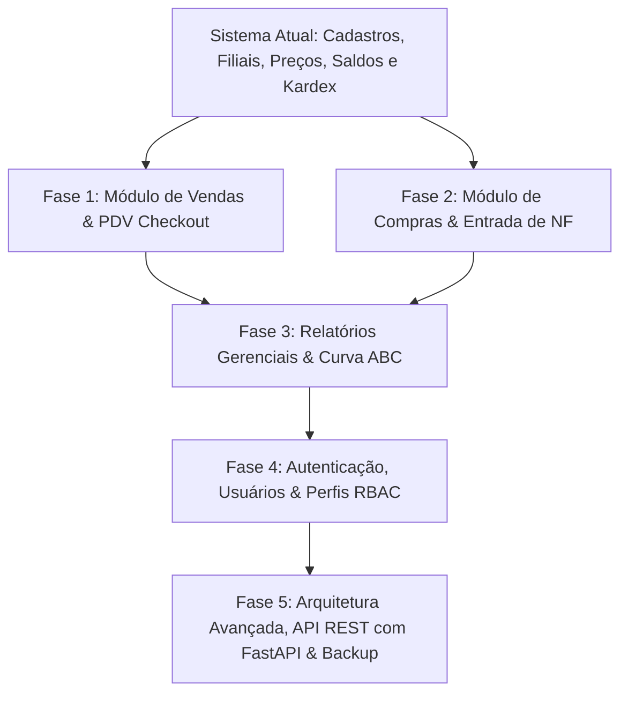

# 📚 Guia de Estudos e Roadmap de Evolução Arquitetural
## Sistema de Gestão Empresarial Multi-Filiais (ERP Python)

Este documento foi elaborado para servir como um **roteiro de estudos práticos e avançados**, apresentando oportunidades reais de evolução técnica e de negócios para o seu sistema de gestão.

---

## 🗺️ Mapa de Evolução Recomendado



---

## 🚀 1. Módulo de Vendas e Ponto de Venda (PDV)

### 🎯 Objetivo de Negócio
Permitir que uma filial realize vendas para clientes cadastrados, com múltiplos itens em um carrinho, cálculo automático de descontos/promoções, seleção da forma de pagamento e baixa automática de estoque no Kardex.

### 🧠 O que Estudar:
- **Modelagem 1:N (Mestre-Detalhe)**: Uma venda possui vários itens (`vendas` e `itens_venda`).
- **Transações Atômicas Complexas**:
  1. Inserir cabeçalho da venda (`cliente_id`, `loja_id`, `valor_total`, `data_venda`).
  2. Percorrer os itens, inserindo em `itens_venda` (`produto_id`, `quantidade`, `preco_unitario`, `subtotal`).
  3. Atualizar a tabela `saldos` para cada produto.
  4. Inserir no `movimentacoes_estoque` com tipo `SAIDA` e motivo `Venda Pedido #ID`.
  5. Se qualquer item não tiver estoque suficiente, efetuar `ROLLBACK` total. (ao lançar o item o sistema deverá verificar se tem estoque suficiente, se não tiver, deverá mostrar uma mensagem de erro e não adicionar o item, e continuar no loop para adicionar os outros itens)
  

### 💡 Esquema SQL Sugerido:
```sql
CREATE TABLE IF NOT EXISTS vendas (
    id INTEGER PRIMARY KEY AUTOINCREMENT,
    cliente_id INTEGER NOT NULL,
    loja_id INTEGER NOT NULL,
    data_venda TEXT NOT NULL,
    valor_total REAL NOT NULL,
    forma_pagamento TEXT NOT NULL CHECK (forma_pagamento IN ('PIX', 'DINHEIRO', 'CARTAO_CREDITO', 'CARTAO_DEBITO', 'BOLETO')),
    status TEXT NOT NULL DEFAULT 'CONCLUIDA' CHECK (status IN ('CONCLUIDA', 'CANCELADA')),
    FOREIGN KEY (cliente_id) REFERENCES clientes (id),
    FOREIGN KEY (loja_id) REFERENCES lojas (id)
);

CREATE TABLE IF NOT EXISTS itens_venda (
    id INTEGER PRIMARY KEY AUTOINCREMENT,
    venda_id INTEGER NOT NULL,
    produto_id INTEGER NOT NULL,
    quantidade INTEGER NOT NULL CHECK (quantidade > 0),
    preco_unitario REAL NOT NULL,
    subtotal REAL NOT NULL,
    FOREIGN KEY (venda_id) REFERENCES vendas (id) ON DELETE CASCADE,
    FOREIGN KEY (produto_id) REFERENCES produtos (id)
);
```

---

## 📦 2. Módulo de Compras e Custo Médio Ponderado

### 🎯 Objetivo de Negócio
Registrar pedidos de compra a fornecedores para reposição de mercadorias no Centro de Distribuição (CD) ou lojas, recalculando o **Custo Médio** do produto.

### 🧠 O que Estudar:
- **Custo Médio Ponderado (CMP)**:
  $$\text{Novo Custo Médio} = \frac{(\text{Estoque Atual} \times \text{Custo Atual}) + (\text{Qtd Comprada} \times \text{Custo Novo})}{\text{Estoque Atual} + \text{Qtd Comprada}}$$
  *Exemplo:* Você tem 10 unidades a R\$ 10,00 (Total R\$ 100). Compra mais 10 a R\$ 14,00 (Total R\$ 140). Seu novo estoque é 20 unidades com custo médio de R\$ 12,00 cada.

---

## 📊 3. Relatórios Gerenciais e Analytics de Negócios

### 🎯 Objetivo de Negócio
Transformar os dados brutos de estoque, movimentações e vendas em inteligência comercial para tomada de decisão.

### 🧠 Tópicos para Estudo e Implementação:
1. **Curva ABC de Estoque / Pareto (80/20)**:
   - **Classe A**: 20% dos produtos que representam 80% do valor do estoque/faturamento.
   - **Classe B**: 30% dos produtos que representam 15% do valor.
   - **Classe C**: 50% dos produtos que representam apenas 5% do valor.
2. **Ponto de Reposição e Giro de Estoque**:
   - Alertar produtos cujo saldo está abaixo do `estoque_minimo`.
   - Calcular quais produtos estão "parados" no CD há mais de 60 dias sem movimentação.
3. **Demonstrativo de Resultado Simplificado (DRE)**:
   - $\text{Faturamento Bruto} - \text{Custos de Mercadoria (CMV)} = \text{Lucro Bruto}$.

---

## 🔐 4. Autenticação e Perfis de Acesso (RBAC - Role-Based Access Control)

### 🎯 Objetivo de Negócio
Garantir que cada colaborador acerte apenas no que tem permissão (ex: operador de caixa não pode alterar preço de custo ou inativar filiais).

### 🧠 O que Estudar:
- **Criptografia e Hashing Seguro**: Uso de `hashlib.sha256` ou a biblioteca `bcrypt` com salt para nunca salvar senhas em texto puro.
- **Tabela de Usuários e Perfis**:
  - Perfis: `ADMIN`, `GERENTE`, `OPERADOR_CAIXA`, `ESTOQUISTA`.
- **Decorators em Python para Controle de Acesso**:
  ```python
  def requer_perfil(*perfis_permitidos):
      def decorator(funcao):
          def wrapper(*args, **kwargs):
              if usuario_logado['perfil'] not in perfis_permitidos:
                  print("⛔ Acesso negado! Você não tem permissão para esta ação.")
                  return
              return funcao(*args, **kwargs)
          return wrapper
      return decorator
  ```

---

## 🏛️ 5. Arquitetura de Software & Engenharia de Dados

### 🧠 Padrões de Projeto (Design Patterns) para Estudar:
1. **Repository Pattern / DAO (Data Access Object)**:
   - Criar classes específicas como `ProdutoRepository`, `ClienteRepository`, `FilialRepository` para desacoplar 100% as consultas SQL do restante do código.
2. **Service Layer (Camada de Serviços)**:
   - Isolar regras de negócio puras (como cálculo de markup, transferências, regras de desconto) das chamadas de banco de dados.
3. **Backup Automático do SQLite em Tempo Real**:
   - O SQLite possui uma API nativa fantástica para backup a quente sem travar o banco:
     ```python
     def realizar_backup_banco(origem="sistema.db", destino="backup_sistema.db"):
         conn_origem = sqlite3.connect(origem)
         conn_destino = sqlite3.connect(destino)
         with conn_destino:
             conn_origem.backup(conn_destino, pages=100)
         conn_origem.close()
         conn_destino.close()
     ```
4. **Exportação de Relatórios (CSV / Excel / PDF)**:
   - Usar o módulo nativo `csv` para exportação de dados.
   - Estudar a biblioteca `openpyxl` (geração de planilhas formatadas com fórmulas) e `reportlab` (geração de relatórios em PDF com logotipo).

---

## 🌐 6. Próximos Passos de Interface (Além do CLI)

Quando se sentir confortável com a lógica do terminal, você pode expandir esse mesmo backend para:
1. **API REST com FastAPI**:
   - Transformar as funções do `persistencia.py` em endpoints HTTP JSON (`GET /produtos`, `POST /vendas`, `POST /filiais/transferencia`).
2. **Interface Gráfica Desktop**:
   - `CustomTkinter` (moderno e simples) ou `PyQt6` / `Flet`.
3. **Dashboard Web**:
   - Desenvolver um painel moderno em `Streamlit` para visualização dos gráficos de faturamento e estoque.

---

## 📖 Livros e Referências Recomendadas
- *Pense em Python* (Allen B. Downey)
- *Python Fluente* (Luciano Ramalho)
- *Arquitetura Limpa (Clean Architecture)* (Robert C. Martin)
- *Designing Data-Intensive Applications* (Martin Kleppmann)
